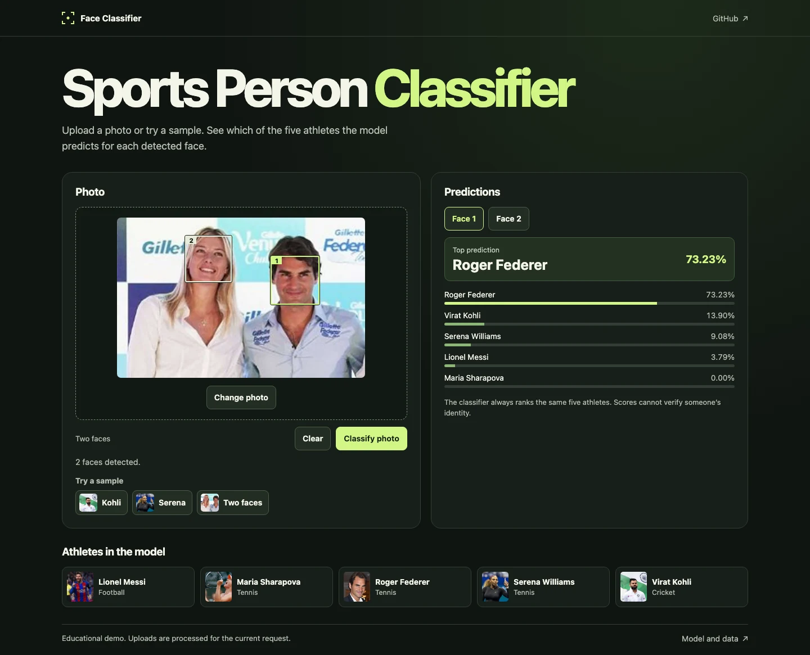

# Sports Person Classifier

[](https://github.com/prathamkashyap/Facial-Image-Classification/actions/workflows/ci.yml)

An interactive image classification demo for Lionel Messi, Maria Sharapova, Roger Federer, Serena Williams, and Virat Kohli. Upload a photo or open a built-in sample to inspect each qualifying face and compare the model’s five class scores.



## Run locally

Use Python 3.11 or 3.12. The bundled model is ready for inference after installing the dependencies.

```bash
git clone https://github.com/prathamkashyap/Facial-Image-Classification.git
cd Facial-Image-Classification
python3.11 -m venv .venv
source .venv/bin/activate
python -m pip install -r requirements.txt
python -m server.server
```

On Windows, create the environment with `py -3.11 -m venv .venv` and activate it from PowerShell with `.venv\Scripts\Activate.ps1`.

Open [the local app](http://127.0.0.1:8000), then select **Two faces** to try the result picker. The app accepts JPEG, PNG, and WebP up to 8 MiB, 12 megapixels, and 6,000 pixels per side. Uploads are processed for the current request.

### CLI and Streamlit

```bash
python -m server.predict UI/test_images/sharapova_3.jpg
```

The CLI prints the same JSON result as the HTTP endpoint. The optional Streamlit interface uses the same image decoder and classifier.

```bash
python -m pip install -r requirements-streamlit.txt
python -m streamlit run app.py
```

## HTTP API

```bash
curl -fsS http://127.0.0.1:8000/healthz
curl -fsS -F "image=@UI/test_images/sharapova_3.jpg" \
  http://127.0.0.1:8000/api/v1/classify
```

| Endpoint | Response |
| --- | --- |
| `GET /healthz` | `200` with `{"status":"ok"}` when the model and detectors load, or `503` when unavailable |
| `POST /api/v1/classify` | Accepts one multipart `image` file and returns oriented image dimensions, the qualifying face count, and up to eight predictions |
| `POST /classify_image` | Accepts a base64 data URL in the `image_data` form field and returns the original result array with class labels and indexed scores |

Each item in `faces` contains a `label`, a pixel `box` with `x`, `y`, `width`, and `height`, and ranked `scores` with a `label` and a percentage `score`. Boxes are relative to the EXIF-oriented image’s top-left corner. The largest qualifying faces appear first. A photo with no qualifying faces returns `200` with an empty `faces` array.

The API reports missing input as `400`, request or image size limits as `413`, unsupported request encoding as `415`, and invalid image files as `422`. Those responses include `error.code` and `error.message`.

## Model and data

OpenCV detects faces and checks for two visible eyes. Each qualifying crop becomes a 4,096-value vector that combines resized color pixels and Haar-wavelet detail. The bundled scikit-learn pipeline standardizes those features and ranks the five fixed classes.

The model gives a score for each class even for a person outside the roster. Treat the scores as relative model output for this educational demo and avoid using them to verify identity. Cropping, lighting, and pose can change the results. The bundled photos demonstrate the interface. They are unsuitable for an independent accuracy estimate because their relationship to the original training set is undocumented.

The original training dataset lives outside this repository. The bundled training artifact was serialized with scikit-learn 1.6.1, which is pinned for compatibility. Load joblib artifacts only from sources you trust. The repository’s sample photos retain their original rights and have incomplete provenance records. [scikit-learn model persistence](https://scikit-learn.org/stable/model_persistence.html)

### Retrain with your own labeled photos

Place photos you have permission to use in these five folders. Each class needs at least five distinct usable photos after screening.

```text
dataset/
  lionel_messi/
  maria_sharapova/
  roger_federer/
  serena_williams/
  virat_kohli/
```

```bash
python -m server.train --dataset /path/to/dataset --output outputs/run-01
CLASSIFIER_ARTIFACT_DIR=outputs/run-01 python -m server.predict UI/test_images/sharapova_3.jpg
```

The trainer uses the same feature extraction as inference and keeps images with one qualifying face. It removes identical feature vectors before a seeded, stratified 75/25 split. It writes a fitted model, the class dictionary, and `evaluation.json` into a new directory. The report includes screening counts, per-class precision and recall, F1, and a confusion matrix with actual classes on rows and predictions on columns. Near-duplicate photos can still inflate scores, so use an independently sourced test set to assess generalization.

The [original notebook](sports_person_classifier_model.ipynb) documents the exploratory work. Its optional dependencies include Jupyter, Matplotlib, pandas, and seaborn.

## Development

```bash
python -m pip install -r requirements-dev.txt
ruff check app.py server tests
ruff format --check app.py server tests
node --check UI/app.js
python -m pytest -q
```

GitHub Actions runs these checks on Linux for Python 3.11 and 3.12. The test suite covers valid and invalid uploads, image limits, orientation, multiple faces, legacy response compatibility, and training artifact creation.

The browser interface lives in [`UI/`](UI/), the Flask API and inference code in [`server/`](server/), and the automated tests in [`tests/`](tests/). The [Procfile](Procfile) starts Gunicorn on the host’s `PORT` on Unix.
